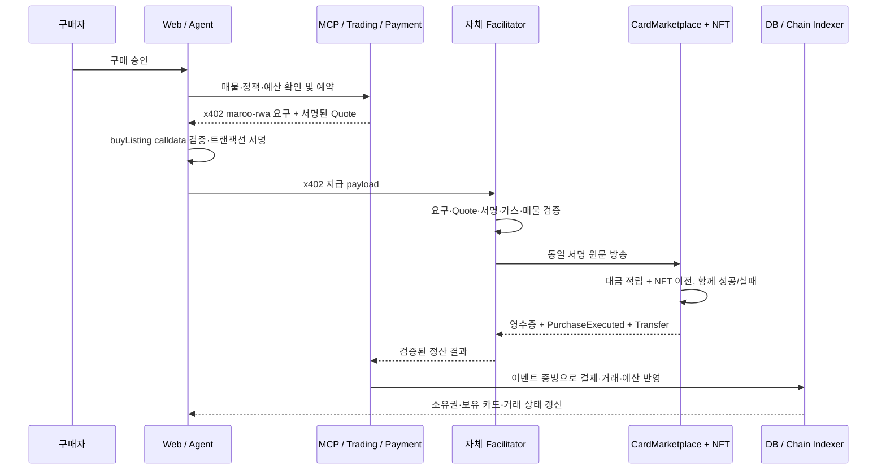

# 카드 RWA 및 마루 NFT 거래 설계

상태: 설계안 / 2026-11-28. 현재 동작하는 기능과 구분하며 이 문서 작성으로 배포·Migration·기존 거래 변경을 수행하지 않는다.

## 목표와 범위

실물 카드 한 장을 보관하고 그 카드의 보관·인출 권리를 나타내는 ERC-721 NFT 하나를 발행한다. 거래할 때 실물을 배송하지 않고 마루에서 tOKRW 결제와 NFT 소유권을 교환한다. 실물과 NFT의 연결은 보관자의 검수·증빙·인출 규칙으로 뒷받침한다. 컨트랙트가 실물의 존재나 상태를 스스로 검증하지는 못한다.

첫 구현은 합성 보관 기록을 명시하는 테스트넷 데모로 진행한다. 실제 보관·감정·배송을 제공한다고 표시하지 않는다. 단일 보관자, 플랫폼 NFT 컬렉션 한 개, 고정가 판매, 사용자 구매 승인 후 에이전트 자동 서명만 포함한다. 분할 소유권·대출·로열티·경매·외부 NFT 등록·백그라운드 자율 구매는 제외한다. 실물 인출은 요청·잠금·취소·관리자 완료까지 시뮬레이션한다.

## 핵심 결정

| 구분 | 설계 |
| --- | --- |
| NFT 표준 | ERC-721, 실물 개체별 1개 |
| 체인·결제 | Maroo Testnet, 네이티브 tOKRW 18자리 |
| 소유권 기준 | NFT 컨트랙트의 ownerOf와 에스크로의 권리자 기록 |
| 판매 | 판매자가 NFT를 마켓 컨트랙트에 예치 |
| 구매 | payable 컨트랙트 호출 한 번으로 대금 적립과 NFT 이전 |
| 판매 대금 | 컨트랙트가 판매자 지갑별 출금 가능 잔액으로 적립 |
| x402 | 별도의 자체 maroo-rwa 확장, 기존 maroo-native 유지 |
| DB | 체인 이벤트의 조회용 사본과 오프체인 업무 상태 |
| 실물 인출 | NFT 잠금 후 보관자 확인, 완료 시 소각 |

현재 플랫폼 수납 지갑으로 직접 보내는 결제와 달리 RWA 구매의 수납 대상은 마켓 컨트랙트다. 판매 대금도 기존 DB 판매 대금과 별개로 컨트랙트에 적립한다. 초기 수수료는 0으로 고정하고, UI에서 출금 가능 온체인 잔액과 기존 내부 원장 잔액을 구분한다.

## 데이터 식별

`CardVariant`는 판본·언어·상태 등 검색·평가 대상이다. 같은 판본 카드가 여러 장 존재하므로 `cardVariantId`를 NFT의 유일 식별자로 사용하지 않는다.

```text
CardVariant 1 ── N PhysicalCard 1 ── 1 TokenizedCard
                           │              │
                        보관 증빙      chainId + contract + tokenId
                                          │
                                    InventoryItem 1개
```

- PhysicalCard: 실물 개체 UUID, cardVariantId, 보관 식별자, 봉인 번호, 감정 정보, 검수 시각, 보관 상태, 증빙 해시, DEMO/VERIFIED 구분.
- TokenizedCard: physicalCardId, chainId, NFT 주소, tokenId, 민팅 tx, 토큰 상태. physicalCardId와 `(chainId, contract, tokenId)`를 각각 유일하게 제한한다.
- WalletBinding: 사용자·에이전트와 지갑의 검증된 연결. 데모의 공용 에이전트 지갑을 다중 사용자별 소유권으로 간주하지 않는다. 우선 단일 구매자·별도 판매자 지갑으로 시연한다.
- RwaListing: 기존 Listing에 대응하는 별도 온체인 listingId·판매자 주소·예치 tx·수량 1·가격·만료·상태.
- RwaSettlement: quoteId, listingId, buyer, NFT 수령 주소, NFT/토큰, 금액, calldataHash, scheme, txHash, blockHash, 완료 이벤트 위치.
- RedemptionRequest: 실물·토큰·요청자 지갑, 온체인 요청 ID, 잠금/취소/소각 tx, 배송 업무 상태.
- ChainEvent/ChainCursor: `(chainId, txHash, logIndex)` 중복 방지, blockHash·확정 상태·스캔 위치 저장.

위 모델명과 필드는 제안이며 기존 DB 스키마를 아직 변경하지 않는다. tokenId는 uint256을 보존하는 정수 문자열, 컨트랙트 주소 비교·유일성은 정규화한 값으로 처리한다. 새 SQL schema가 필요하면 Prisma datasource의 schemas 목록과 Migration을 함께 갱신한다.

## 컨트랙트

### CardVaultNFT

OpenZeppelin ERC721·AccessControl을 기반으로 비업그레이드형 컨트랙트를 만든다. 구현 시 검증할 Solidity·라이브러리 버전을 고정한다.

| 인터페이스 개요 | 호출자와 조건 |
| --- | --- |
| mint(to, physicalCardHash, metadataDigest, uri) | MINTER_ROLE, 보관 확인 후 발행, 같은 실물 해시의 재발행 금지 |
| ownerOf / tokenURI / safeTransferFrom | 표준 ERC-721, 보관 중인 활성 토큰만 이전 가능 |
| requestRedemption(tokenId, requestId) | 현재 소유자만 가능, NFT를 인출 에스크로로 잠금 |
| cancelRedemption(requestId) | 요청자만 가능, 보관자가 반출 승인하기 전 원래 지갑으로 반환 |
| approveRelease(requestId) | CUSTODIAN_ROLE, 이후 사용자 취소 금지 |
| finalizeRedemption(requestId) | CUSTODIAN_ROLE, 반출 확인 후 잠긴 NFT 소각 |
| abortRelease(requestId, reasonHash) | CUSTODIAN_ROLE, 반출하지 못한 승인 요청을 잠금 상태로 되돌림 |

인출 에스크로는 NFT 컨트랙트 내부에 구현하고 요청자의 권리를 별도로 기록한다. 잠긴 NFT는 일반 이전·판매가 불가능하다. 민팅된 실물 해시는 소각 후에도 사용 이력을 남긴다. 재입고·재발행은 첫 범위에서 제외한다.

metadataDigest는 최초 증빙을 고정한다. 개인정보·상세 보관 위치·배송 주소·개인정보의 단순 해시는 체인에 올리지 않는다. 공개 메타데이터는 카드 이미지·판본·봉인 식별용 공개 정보·증빙 버전·데모 여부만 담는다. 최초 증빙의 수정은 허용하지 않고 보관 사고·상태 변경은 추가 이벤트와 DB 이력으로 남긴다.

인출 시 서버 검증만으로 잠그지 않고 NFT를 실제 예치한다. 관리자는 다른 지갑의 활성 NFT를 임의로 소각하거나 이전할 수 없다. 판매 에스크로에 있는 토큰은 판매자 자신이 ownerOf가 아니므로 먼저 판매를 취소해야 인출할 수 있다.

### CardMarketplace

플랫폼 CardVaultNFT 주소를 생성 시 고정한다. 임의 NFT·임의 외부 호출을 받지 않는다. NFT 예치는 createListing 실행 중 예상한 토큰·전송자만 onERC721Received에서 수락한다.

| 인터페이스 개요 | 동작 |
| --- | --- |
| createListing(tokenId, price, expiresAt) | 소유자 호출, 해당 NFT 한 개 승인 후 예치, 새 listingId 발급 |
| cancelListing(listingId) | 판매자만 호출, NFT 반환, listingId 재사용 금지 |
| buyListing(quote, quoteSignature) payable | 구매자·견적 서명·만료·가격·NFT 검증 후 대금 적립과 NFT 이전 |
| withdrawProceeds(to) | 판매자가 자기 잔액 출금, 상태를 먼저 차감하고 전송 |

구매 조건은 ACTIVE 매물, 보관 중인 NFT, msg.sender=quote.buyer, recipient=buyer(첫 범위), msg.value=매물 가격=quote.amount, 유효한 온체인 deadline, 미사용 quoteId, 해당 NFT의 마켓 예치다. 취소·만료·인출·중복 구매는 revert한다.

Quote는 EIP-712 구조로 서명하며 domain에 chainId·verifyingContract, 본문에 quoteId·listingId·nft·tokenId·buyer·recipient·seller·amount·deadline·policyId/version의 해시를 넣는다. 서버의 QUOTE_SIGNER가 정책 확인 후 발급하고 컨트랙트는 그 권한을 검증한다. 기한은 block.timestamp 기준 초 단위로 고정하며 API ISO 시각과 일관되게 변환한다. 견적 서명 권한은 NFT 발행·보관 관리 권한과 분리한다.

buyListing은 매물을 SOLD로 바꾸고 판매자의 proceeds를 증가시킨 뒤 NFT를 safeTransferFrom한다. 어느 단계든 실패하면 전체 revert한다. 외부 수납 지갑으로 먼저 송금하지 않는다. NFT 수령 콜백·출금에는 상태 선변경과 저장소 기반 ReentrancyGuard를 적용한다. 활성 매물의 가격 변경은 취소 후 재등록으로 처리한다.

EIP-712 견적 서명과 구매자의 EVM 트랜잭션 서명은 서로 다르다. 사용자 정책·누적 예산은 기존 서버가 관리하며 policy 해시를 기록한다고 예산 전체가 온체인에서 강제되는 것은 아니다. 스마트 계정의 온체인 예산 제한은 후속 범위다.

소유권 이전·민팅·신규 판매·구매의 일시 중지는 역할로 제한한다. 일시 중지 시 판매 취소·인출 요청 취소·판매 대금 출금의 허용 조건은 별도로 정의해 정상 자산 반환을 지원한다. 데모에서는 관리자 EOA를 사용할 수 있으나 사용자가 가진 NFT를 임의 회수하는 기능은 만들지 않는다.

## 구매 흐름과 x402 확장



현재 `maroo-native`는 EOA 수납처만 허용하며 data는 주문 태그다. 이 경로의 EOA 제한을 단순 제거하지 않는다. 새 `maroo-rwa` 프로필에서 payTo=마켓 주소, asset=native:tOKRW, amount=매물 가격, extra에 NFT/토큰/listing/quote/deadline/calldataHash/ABI 버전과 견적 서명을 포함한다. 이는 공식 EVM exact가 아닌 자체 x402 v2 확장이다.

Signer·Facilitator 양쪽에서 허용된 배포 주소·런타임 코드 해시·함수 selector와 calldata를 완전히 디코딩해 기대한 값과 비교한다. 임의 target, approve, multicall, delegatecall은 허용하지 않는다. chainId·value·nonce·buyer·recipient·유효기간·견적 서명·가스 한도도 검사한다. 서버는 현재 매물 상태를 eth_call로 시뮬레이션한다. 시뮬레이션 성공은 이후 체결을 보장하지 않으며 최종 결과는 영수증으로 결정한다.

트랜잭션 data가 buyListing 호출이므로 마켓이 deadline을 온체인에서 검사한다. 기존 단순 송금의 오프체인 만료와 차이가 있다. 가스는 실제 배포 컨트랙트 호출로 추정하고 RWA 프로필의 검증된 상한을 따로 정한다. 기존 단순 송금의 300,000 gas·2 tOKRW 상한을 측정 없이 재사용하지 않는다. 견적 발행·NFT 발행·매물 등록·출금의 가스 주체도 각각 운영자·판매자·구매자로 구분한다.

## 정산·동기화·복구

receipt 성공과 동일 허용 마켓에서 발생한 PurchaseExecuted 이벤트의 quoteId·listingId·buyer·recipient·seller·NFT·tokenId·amount를 검증한다. 같은 영수증에서 예상 NFT의 Transfer(마켓→구매자)도 확인한다. 단순 tOKRW 잔액 증가나 RPC가 알려준 해시만으로 SETTLED로 판정하지 않는다.

온체인 성공 후 DB 업데이트가 실패하면 DB를 FINALIZING/RECONCILING으로 유지하고 같은 해시·이벤트에서 재시도한다. NFT를 다시 보내거나 새 결제를 만들지 않는다. 정산 증빙 반영 시 사용 예산 증가와 예약 예산 해제를 한 번만 처리하고 Trade/조회용 소유권 반영도 유일 키로 중복 방지한다. 체인 성공을 DB 롤백만으로 취소했다고 표시하지 않는다.

revert가 확정되면 가격은 결제되지 않지만 가스비는 발생한다. 예약 예산은 해제하고 매물의 실제 체인 상태에 따라 DB를 갱신한다. 타임아웃·미확정이면 예약 예산을 유지하고 기존 해시만 확인한다. 방송 전 해시 보존·nonce 중복 방지·원문 비저장 원칙을 유지한다.

Indexer는 NFT Transfer뿐 아니라 ListingCreated/Cancelled/PurchaseExecuted 및 Redemption 이벤트를 함께 처리한다. 마켓 예치 중 beneficial owner는 판매자, 인출 예치 중 권리자는 인출 요청자다. ownerOf가 마켓으로 바뀌었다고 플랫폼을 실물 권리자로 표시하지 않는다. 외부 지갑 간 직접 이전도 수집하며 미등록 주소는 주소로 표시하고 임의의 사용자에게 연결하지 않는다.

이벤트 처리 위치와 blockHash를 저장한다. 체인에서 사용할 확정 기준은 구현 시 검증·설정하고 미확정 이벤트는 확정 소유권과 구분한다. 누락 구간 재스캔·블록 해시 불일치 시 조회 사본 재구성을 지원한다. 구매 당시 영수증과 최신 ownerOf가 다르면 이후 이전인지 확인하며 정상적인 재판매를 첫 거래 실패로 처리하지 않는다.

## 실물 인출과 보관

입고 → 검수 → 보관 확인 → 민팅 순서다. 검수자는 봉인 번호·사진·감정 정보와 실물 식별자를 확인하고 보관 증빙을 기록한다. 같은 개체의 중복 민팅은 DB·컨트랙트에서 차단한다. 물리적 동일성을 해시만으로 보장할 수 없으므로 실제 서비스에는 실물 대조 절차가 필요하다.

인출은 REQUESTED(온체인 잠금) → RELEASE_APPROVED → REDEEMED(소각)로 진행한다. 반출 승인 전에는 요청자가 취소할 수 있고, 승인 이후 보관자가 반출을 수행하거나 미반출을 확인해 승인 취소한다. 실제 반출과 온체인 소각은 원자적으로 묶을 수 없다. 반출 후 소각 트랜잭션 실패 시 토큰을 잠긴 채 유지하고 같은 요청의 완료만 재시도한다. 소각 실패를 이유로 NFT를 반환하거나 같은 카드를 다시 배송하지 않는다.

택배 접수·배송 실패·분실의 책임과 재처리 절차는 오프체인 보관 약정에 필요하다. NFT 소각 기록으로 배송 완료를 단정하지 않는다. 첫 데모에서는 모든 보관·반출 상태를 시뮬레이션으로 표시한다.

## 저장소와 통합 범위

```text
contracts/                       # 새 Solidity 프로젝트, pnpm의 packages/contracts와 구분
  src/CardVaultNFT.sol
  src/CardMarketplace.sol
  test/
  script/
  deployments/                   # 공개 체인·주소·코드 해시·배포 블록
packages/rwa/                    # ABI·체인 조회·증빙 검증·Indexer·보관 서비스
packages/contracts/src/rwa.ts    # 공통 DTO와 Zod Schema
packages/db/prisma/schema/rwa.prisma
apps/api/src/plugins/rwa.ts      # 서비스 등록·REST 조립
```

Foundry를 Solidity 테스트·배포 도구로 사용하는 안이다. ABI와 배포 정보는 검증한 결과만 공개 패키지에 제공한다. 개인키·빌드 캐시·방송의 비밀 원문은 커밋하지 않는다. 기존 Trading·Payment·MCP 소유 모듈에는 새 정산 타입과 증빙 경계의 최소 변경을 제안하고 계약을 맞춘 후 적용한다. 설계 단계에서는 다른 담당자의 로직을 수정하지 않는다.

REST는 `/api/rwa/assets/:id`, `/api/rwa/tokens/:id`, `/api/rwa/listings`, `/api/rwa/redemptions`와 판매 대금 조회·출금 요청을 추가하는 안이다. 민팅·보관 변경은 별도 관리자 권한으로 제한한다. MCP 검색은 유지하고 RWA 매물의 quote/execute/status가 새 scheme으로 연결되게 한다. 구매 도구에 민팅·보관 승인 권한을 주지 않는다.

기존 카드·재고·거래를 일괄 NFT로 변환하지 않는다. 별도 데모 재고를 추가하고 settlementKind로 기존 DB 거래와 RWA 거래를 구분한다. 공통 Payment가 EOA 송금용 증빙을 RWA 거래에 사용하거나 DB 소유권만 바꾸어 NFT 거래 완료로 처리하지 못하게 한다. 기존 모드의 기본 동작과 이력을 유지한다.

화면에는 실물/데모 보관 구분, NFT 주소·tokenId·탐색기, 권리자 지갑, 판매 예치·구매 확정 상태를 표시한다. 구매 전 결제액·별도 예상 가스비·받을 NFT를 보여준다. 판매자는 NFT 승인→예치→판매 대금 출금 단계를 볼 수 있어야 한다. 실물 인출은 매물 취소 후 별도 화면에서 요청한다.

## 구현 순서와 완료 기준

1. ERC-721 발행·중복 발행 차단·NFT 예치 판매·원자적 구매·출금 컨트랙트와 로컬 테스트.
2. 마루 테스트넷에 소액으로 배포·호출해 가스·수신 콜백·이벤트·PCL 동작 확인. 직접 호출의 Open Path로 시작하며 PCL 규제 경로 적용을 완료했다고 표시하지 않음.
3. 별도 RWA 데모 데이터·DB 모델·지갑 연결·이벤트 동기화 구현.
4. maroo-rwa Signer·Facilitator·Payment 증빙과 MCP 연결. 기존 모드 회귀 검증.
5. 보유 NFT·판매·구매·대금 출금 UI 및 인출 시뮬레이션.
6. 구매 한 건의 NFT/대금 동시 처리, 재시도 중복 방지, DB 복구를 테스트넷에서 검증.

필수 테스트는 권한 없는 민팅·중복 실물·승인 없는 예치·매물 취소와 구매 경합·만료/잘못된 가격/다른 구매자/다른 체인/변조된 calldata·견적 재사용·수신 콜백 실패·출금 재진입·NFT 잠금·승인 후 인출 취소 금지·중복 소각·이벤트 중복/누락·DB 실패 후 복구·확정 revert의 예산 해제다. 성공 시 결제만 되고 NFT가 오지 않는 상태가 없어야 한다. 미확정 상태에서 새 지급이 생기지 않아야 한다.

컨트랙트 배포 전에는 ABI·기능·가스비를 테스트넷에서 검증한다. 현재 문서는 ERC-721의 마루 실배포 호환성이나 보관 권리의 법적 효력을 검증한 결과가 아니다.

## 참고 근거

- [ERC-721](https://eips.ethereum.org/EIPS/eip-721): 개별 NFT 소유권·이전 인터페이스.
- [OpenZeppelin ERC721](https://docs.openzeppelin.com/contracts/5.x/api/token/erc721): 표준 구현과 수신 콜백 동작.
- [OpenZeppelin Access Control](https://docs.openzeppelin.com/contracts/5.x/access-control), [ReentrancyGuard](https://docs.openzeppelin.com/contracts/5.x/api/utils): 역할 분리와 재진입 방어.
- [마루 테스트넷 접속](https://docs.maroo.io/resources/network/testnet-access/): EVM·네이티브 통화·컨트랙트 배포·가스 특성.
- [마루 PCL 경로](https://docs.maroo.io/en/concepts/compliance/pcl-dual-track-model): 직접 호출과 PCL proxy 경로의 구분.
- [현재 마루 결제](./maroo.md): EOA 송금 방식과 실제 검증 범위.
